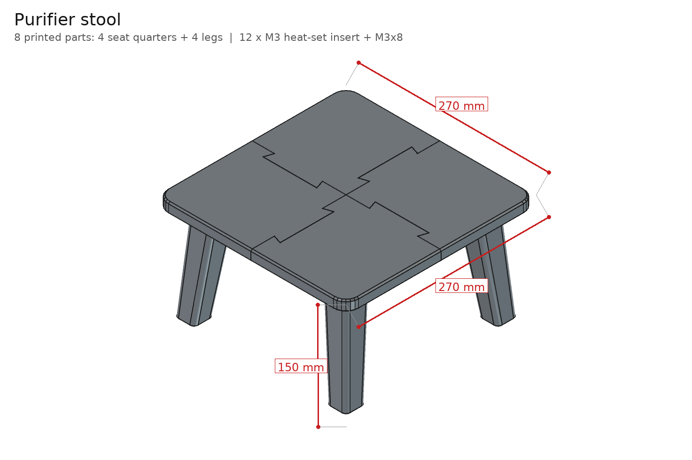
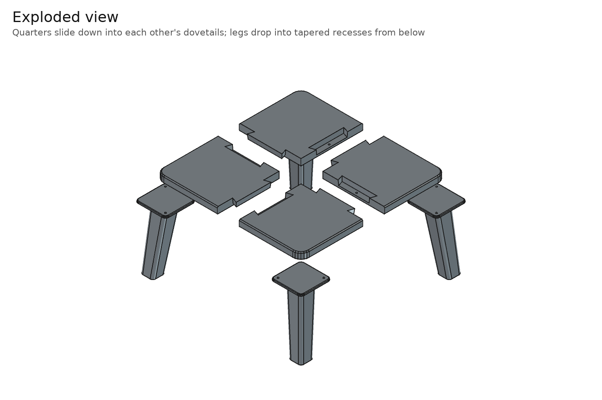
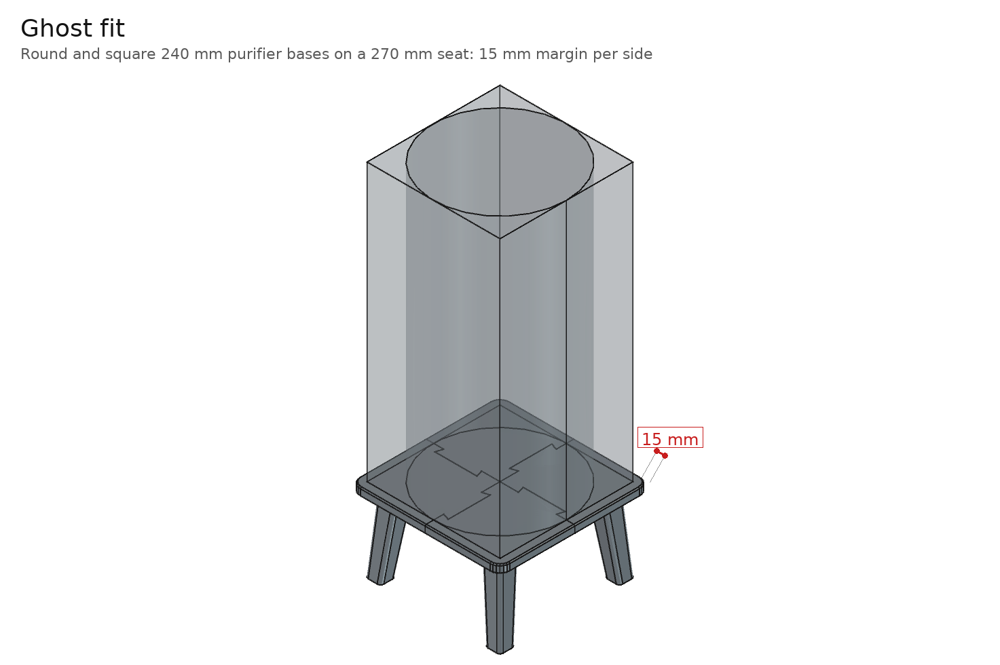

# Purifier stool

<p>
  
  
</p>

A 3D-printable stool that lifts an air purifier 150 mm off the floor. It prints as
8 parts on a 180 mm bed (Bambu A1 mini) and assembles **without glue**: dovetails and
M3 screws into heat-set inserts. It is fully parametric: one FreeCAD macro holds every
dimension and checks the geometry.

## Size

| | mm |
|---|---|
| Seat | 270 x 270 |
| Height | 150 |
| Seat thickness | 14 |
| Leg footprint | 242 x 242 (legs splay out 14) |
| Load base | up to 240 (round or square), 15 margin per side |
| Load | 2 kg (designed for; not load-tested) |



## Parts

| Print | Qty | Size (mm) | Volume |
|---|---|---|---|
| `stool-seat-quarter-x4.stl` | 4 | 147 x 135 x 14 | 235 cm^3 |
| `stool-leg-x4.stl` | 4 | 67.5 x 67.5 x 140 | 149 cm^3 |
| M3 heat-set insert, 6 mm long (M3 x 6, ~3.9 mm OD) | 12 | | |
| M3 x 8 countersunk screw (ISO 10642) | 12 | | |

All four quarters are identical; so are the four legs.

## Design

- **Seat joints:** each seam is one wide vertical dovetail. It blocks the quarters from
  pulling apart sideways. One M3 screw through the socket shelf into an insert in the
  tongue stops it lifting out. Dovetail walls are drafted 5 deg with a constant
  0.25 mm gap, so the narrow end leads in.
- **Leg mount:** each leg flange drops into a recess under the seat. Flange and recess
  walls taper 15 deg, so the leg self-centres, then two M3 screws hold it. The flange
  sits flush; the screws are reachable from below past the leg.
- **Inserts:** every pilot hole (3.6 mm, 6.4 mm deep) has a 0.5 x 1 mm flared mouth to
  guide the hot insert.
- **Edges:** 2 mm chamfer on the seat top, 1 mm round under the rim and on the feet,
  1 mm chamfers on the flange, 6 mm rounded leg corners.

## Print

The STLs are already in print orientation. No support.

- **Seat quarter: top face on the bed.** The recesses and dovetail sockets then open
  upward. The socket roof is a short 12 mm bridge; check it in the slicer.
- **Leg: flange on the bed.** The leg tapers gently upward from it.
- PETG or PLA, 4 walls, 20-30 % gyroid infill, 0.4 mm nozzle.

## Assembly

1. Press the 12 inserts in with a soldering iron: 1 under each dovetail tongue,
   2 in each leg recess.
2. Slide the quarters down into each other's dovetails, top face up.
3. Turn the seat over. Screw each seam through its shelf hole (4 x M3 x 8).
4. Drop each leg into its recess and screw it down (8 x M3 x 8).

Before printing a full set, print one quarter and one leg and test the dovetail, the
recess fit and an insert. `FIT` and `INSERT_PILOT` are the parameters to adjust.

## Build

FreeCAD here is the Flatpak. Pass the macro by absolute path.

```sh
# Dimension checks only, no FreeCAD needed.
python3 build.FCMacro --check

# Full build: writes out/stool-seat-quarter-x4.stl, out/stool-leg-x4.stl,
# out/stool-stand.step (assembly) and out/stool-stand.FCStd.
flatpak run --command=FreeCADCmd org.freecad.FreeCAD "$PWD/build.FCMacro"
```

`scripts/render.py` makes the pictures in `docs/`. It needs the FreeCAD GUI: run
`build.FCMacro`, then `render.py`, in the same session.

## Parameters

Change sizes at the top of `build.FCMacro`, not by scaling the STL: scaling also
changes the fits, the screw holes and the insert pockets.

| Parameter | Default | |
|---|---|---|
| `SEAT_WIDTH` | 270 | Square seat edge |
| `HEIGHT` | 150 | Floor to seat top |
| `SEAT_THICK` | 14 | Seat plate |
| `LOAD_BASE` | 240 | Widest base the seat must carry |
| `LEG_SPLAY` | 14 | How far each foot sits outside its flange |
| `FIT` | 0.25 | Clearance per side, dovetail and leg recess |
| `INSERT_PILOT` | 3.6 | Insert hole; calibrated for one printer, test yours |
| `BED` | 180 | Printer build volume edge |

The checks reject values that do not work, for example a seat whose quarter no longer
fits the bed, or a load base without 10 mm of margin.

## Downloads

STL, STEP and FCStd are attached to each [release](../../releases). Pushing a `v*`
tag builds them in CI from `build.FCMacro`.

## License

[MIT](LICENSE)
